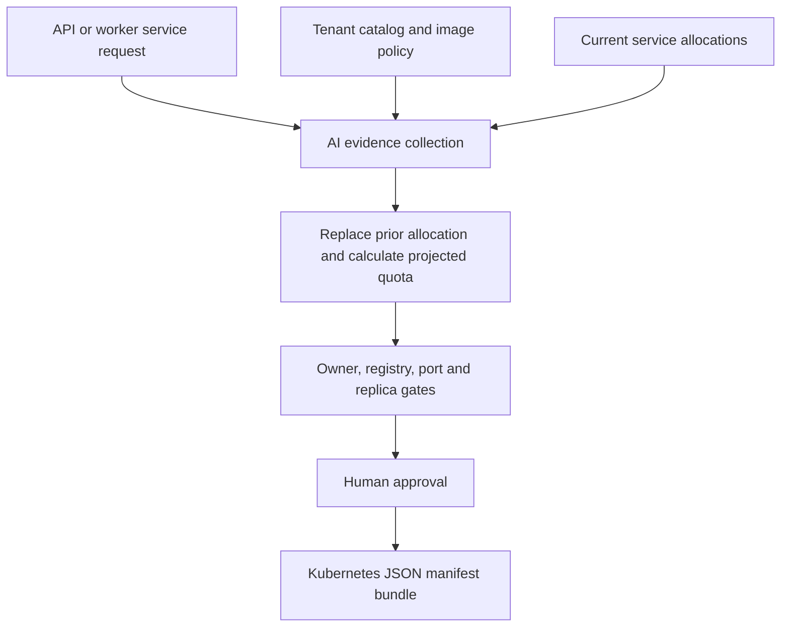

# AI Self-Service Platform Control Plane

Validate service catalog requests against quotas, image policies, and capacity before exporting Kubernetes manifests.

[Architecture](docs/ARCHITECTURE.md) · [Case study](docs/CASE_STUDY.md) · [Runbook](docs/RUNBOOK.md) · [Validation](docs/VALIDATION.md)

## Project Overview

I built a service catalog control plane that validates owner and namespace, immutable image references, ports, replica limits, and projected tenant resource usage. Approved requests export hardened Kubernetes Deployment and Service documents.

## Problem Statement

A self-service request can pass its per-service limits while exhausting tenant quota or selecting an unapproved image registry.

## Architecture



## Technology Stack

| Tool | Implemented role |
| --- | --- |
| Python 3.12, FastAPI, Pydantic | CLI, authenticated API and strict case validation |
| Ollama and Qwen | A bounded model loop selects read-only evidence probes |
| SQLite | Durable reports, idempotency keys, workflow versions and audit outbox |
| Prometheus | Decision counters, latency histogram and hold alert rules |
| Grafana | Provisioned decision and latency dashboard |
| Splunk HEC | Audit event sender, local protocol receiver and SPL searches |
| Docker Compose | API, audit receiver, Prometheus, Grafana and optional model runtime |
| Kubernetes | Persistent single-replica API deployment with security context and probes |
| pytest, Ruff, Bandit, pip-audit | Domain and API tests, lint, source scan and dependency audit |

## Features

- Domain-specific policy checks with cited evidence and captured agent traces.
- A three-call AI loop with constrained tool names and fail-closed handling.
- Retry-safe report creation and version-checked approval and export transitions.
- Persistent audit events with retryable HEC delivery.
- Passing and held fixtures with a labeled replay suite.

## Prerequisites

Use Python 3.12 and Make for the local demo. Docker Compose is optional. Ollama with qwen2.5:0.5b is needed for model-driven runs.

## Quick Start

```sh
python3.12 -m venv .venv
. .venv/bin/activate
python -m pip install -r requirements-dev.txt
make check
python -m ops_platform.service examples/main.json
```

For a real model run, install Ollama, start its server, then run the following commands.

```sh
ollama pull qwen2.5:0.5b
python -m ops_platform.service examples/ready.json --mode ollama
```

[Captured passing model run](reports/live-ready.json) · [Captured held model run](reports/live-hold.json)


## Configuration

Run `python tools/init_env.py` to create private local credentials. Then load them with `set -a; . ./.env; set +a`. The API reads OPS_API_TOKEN and refuses short or placeholder credentials. OPS_DATABASE sets the SQLite filename. OPS_MODEL, OPS_MODEL_HOST and OPS_MODEL_PORT select the local model. SPLUNK_HEC_URL and SPLUNK_HEC_TOKEN enable the audit sender.

Model hosts are limited to loopback and the ollama Compose service. HEC requires verified HTTPS for remote destinations. The local protocol receiver supports HTTP.

## Testing

```sh
make check
python -m pip_audit -r requirements.txt
```

The suite covers domain boundaries, authentication, approval holds, idempotent retries, stale versions, concurrent commands, database restarts, missing evidence, model failure, and HEC retry behavior. The replay suite has 6 labeled scenarios.

## Deployment

Start the API with `make serve`, then run `python tools/http_demo.py` in a second terminal with the same OPS_API_TOKEN. The demo evaluates, retries, approves, exports and retrieves a bundle.

For the complete local stack, run `docker compose up --build -d` after creating .env. Grafana opens at http://127.0.0.1:3000 and Prometheus at http://127.0.0.1:9090. To enable the container model runtime, run `docker compose --profile ai up -d ollama` and `docker compose exec ollama ollama pull qwen2.5:0.5b`. Set DEMO_MODE=ollama when running the HTTP demo.

The [Kubernetes deployment instructions](docs/RUNBOOK.md#kubernetes) explain image loading, credentials, persistent storage, and single-replica operation.

## Monitoring

GET /metrics exposes evaluation counters and duration buckets. Prometheus scrapes them and evaluates the supplied alert rules. Grafana provisions two time-series panels. Audit events stay in SQLite until the HEC receiver returns code 0. This records receiver acceptance, while indexing acknowledgment requires a separate Splunk integration.

## Troubleshooting

See [failure symptoms and fixes](docs/TROUBLESHOOTING.md) and the [operations runbook](docs/RUNBOOK.md).

## Security Considerations

All run and workflow endpoints require a bearer token. The request body is capped at 128 KiB and domain records reject unexpected fields. The model selects from an allowlist of read-only probes. The policy layer controls approval eligibility. Only event IDs, run IDs, workflow actions and versions enter the HEC outbox.

The local API uses one operator credential. Put an identity-aware gateway, tenant authorization and TLS in front of a shared deployment. Keep SQLite and any real telemetry private.

## Limitations

Catalog and usage data are caller-supplied snapshots. The platform does not reserve live cluster capacity or apply manifests. Two concurrent different requests can each pass against the same snapshot, so an external reconciliation controller must serialize real cluster reservations.

Python API flows, real local Qwen calls, and local HEC contract delivery were exercised. Container startup, the Grafana UI, managed infrastructure, and live vendor integrations have their own remaining deployment checks. See [validation scope](docs/VALIDATION.md).

## Future Improvements

A useful golden path needs explicit ownership and resource accounting, including the replacement semantics of updates. The next integration should replace supplied evidence snapshots with authenticated source adapters and preserve the same approval and audit contract.
